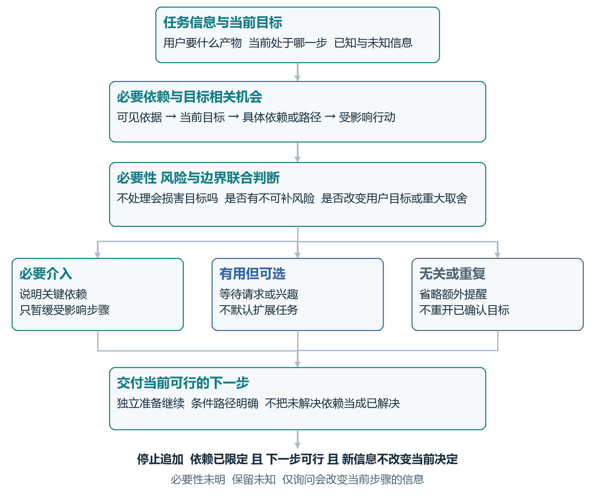

**完整产品设计报告：[阅读 PDF](docs/reports/research-ai-skill-product-design.pdf) · [下载 Word](docs/reports/research-ai-skill-product-design.docx)**

# Research AI Skill

让 AI 在影响科研目标的关键处及时提醒，在条件充分时继续把任务做完。

你可能遇到过这样的科研协作：AI 很快推荐了分析方法，到了采集结束才发现缺少必要记录；或者你只想完成一项准备工作，AI 却不断追加新的要求。

Research AI Skill 围绕这些问题，为 AI 助手提供目标识别、必要依赖检查、介入时机与停止规则。它面向需要与 AI 共同推进研究的研究生、研究者及应用研究团队，帮助专业建议围绕同一个研究目标持续工作。

## 能帮助你做什么？

| 功能 | 对当前任务的帮助 |
| --- | --- |
| 理解目标与当前步骤 | 区分你想支持的研究决定、这次要交付的产物，以及已经确认的条件 |
| 发现关键依赖 | 根据已有资料，识别会改变研究设计、方法选择或后续解释的缺口 |
| 说明方案取舍 | 解释记录、资源和隐私选择各自保留哪些功能，由研究者决定重大取舍 |
| 安排介入时机 | 在真实采集、资料删除或正式提交前确认必要条件，同时继续独立准备 |
| 匹配结论与证据 | 让观察、关联、机制和因果表述与实际资料及设计相匹配 |
| 条件充分时推进 | 完成简单任务或已确认方案，适时结束额外追问与扩展 |

## 适合哪些场景？

- **研究启动与设计讨论**：把“有用”“有效”等愿望转成清楚的研究问题，澄清会改变设计的含义。
- **采集前规划**：核对指标、记录粒度和跨次关联需求，在来得及调整时发现遗漏。
- **分析准备**：依据研究目的与数据结构选择方法，并保留可行的替代路线。
- **结果解释与报告准备**：明确结果支持什么判断，再衔接统计、文献或图表工具完成交付。

例如，你想研究同一个人的跨日变化，却准备只保存每日总体均值。Skill 会引导 AI 说明个体关联记录对该目标的作用，讨论可行路径；已经明确的材料整理仍可继续。若目标只是描述每日整体水平，就按这个目标推进。

## 它如何参与对话？

从当前目标和可见事实出发，判断哪些提醒是必要的，哪些帮助可以按需展开，哪些内容可以省略；随后交付当前可行的下一步。

下图摘自完整产品设计报告，展示核心判断流程：

对话中的重点是具体影响和可执行步骤。资料充分的简单计算直接完成；用户明确要求深入比较时，可以充分展开。

## 如何使用？

1. 下载本仓库，或复制 `SKILL.md`、`rules/`、`references/`、`templates/`，保留目录结构。
2. 按所使用的 AI 工具的 Skill 安装说明，加载包含 `SKILL.md` 的目录。
3. 在对话中选择或请求使用 `research-ai-skill-v2-4-1-1`，说明当前任务。

可以从下面的请求开始：

> 请使用 research-ai-skill-v2-4-1-1 协助我。
>
> 我的研究目标是：……
> 目前已有的材料和已确认条件是：……
> 这一步希望你完成：……

由宿主 AI 工具加载和执行规则；统计计算、文献检索与图表制作使用宿主中可用的相应工具。

## 当前版本与文件

当前版本为 **2.4.1.1，受控试用**。需求来源、设计取舍、产品机制和验证过程见页首完整报告。

| 文件或目录 | 内容 |
| --- | --- |
| [SKILL.md](SKILL.md) | Skill 入口与判断流程 |
| [rules/](rules/) | 输入、证据、介入范围和时点规则 |
| [references/](references/) | 科研协作能力及适用条件 |
| [templates/](templates/) | 澄清、权衡和解释模板 |
| [docs/reports/](docs/reports/) | 完整产品设计报告 PDF 与 Word |

欢迎通过 [Issues](https://github.com/GoYAY/research-ai-skill/issues) 反馈：你当时的目标、提供了哪些信息、AI 如何回应，以及哪一步需要改进。请移除个人材料与凭证后再提交。
